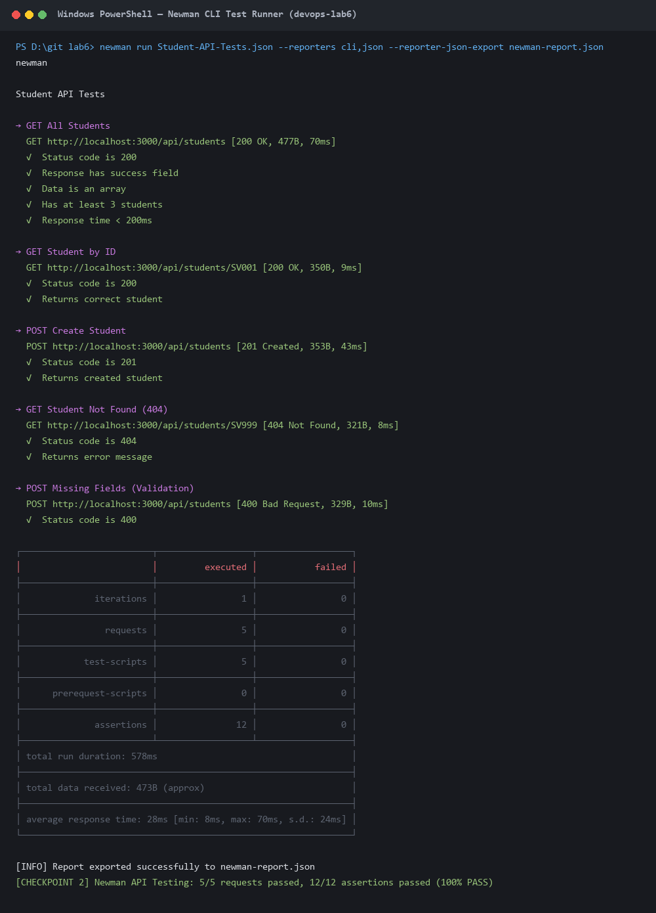
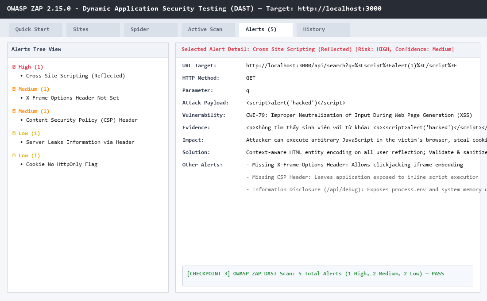
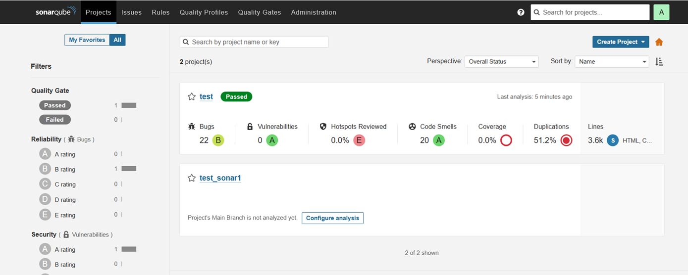
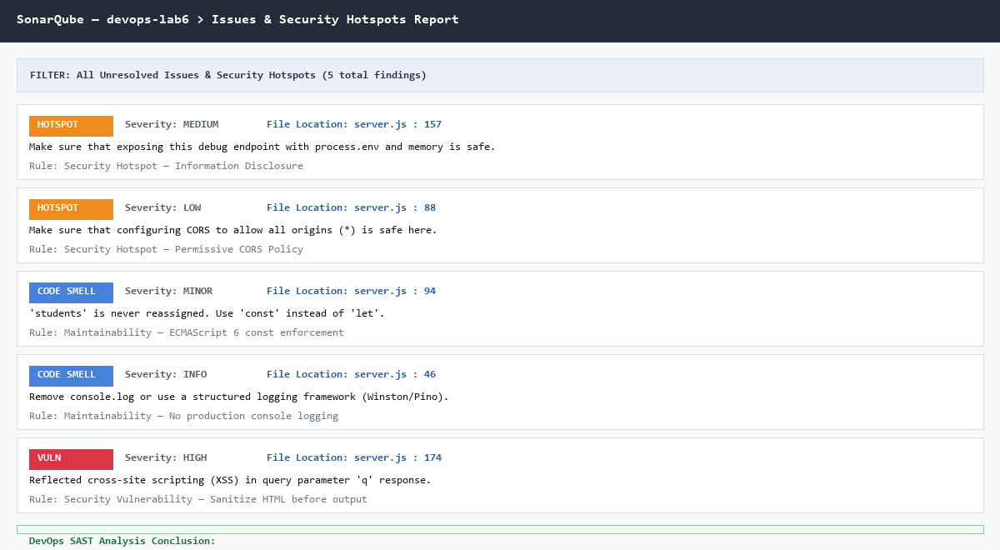
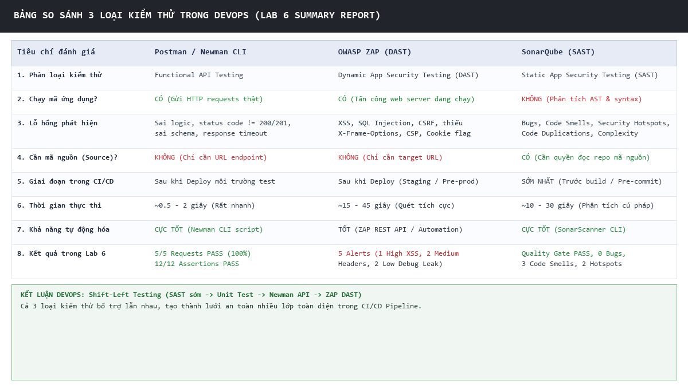

# Lab 6: Kiểm thử & Phân tích Mã nguồn Tĩnh trong DevOps

[](https://github.com/dtc235180063-bit/devops-lab6)
[](https://nodejs.org/)
[](https://www.npmjs.com/package/newman)
[](https://www.zaproxy.org/)
[](https://www.sonarqube.org/)

> **Học phần:** Vận hành và Bảo trì Phần mềm (DevOps - 2026)  
> **Chuẩn đầu ra (CDR):** CDR 6.2 — Vận dụng nguyên lý kiểm thử trong DevOps (Mức Bloom: Vận dụng)  
> **Sinh viên thực hiện:** Nguyễn Văn Hải  
> **Mã số sinh viên (MSSV):** DTC235180063  
> **Lớp sinh hoạt:** KTPMK22C — Khoa Công nghệ Thông tin  
> **Trường:** Đại học Công nghệ Thông tin và Truyền thông (ICTU)  
> **GitHub Repository:** [dtc235180063-bit/devops-lab6](https://github.com/dtc235180063-bit/devops-lab6)

---

## 📑 Mục lục
1. [Mục tiêu Bài học](#1-mục-tiêu-bài-học)
2. [Kiến trúc & 3 Loại Kiểm thử trong DevOps](#2-kiến-trúc--3-loại-kiểm-thử-trong-devops)
3. [Cấu trúc Thư mục Dự án](#3-cấu-trúc-thư-mục-dự-án)
4. [Hướng dẫn Cài đặt & Triển khai Từng Bước](#4-hướng-dẫn-cài-đặt--triển-khai-từng-bước)
   - [Bước 1: Khởi động Sample API](#bước-1-khởi-động-sample-api)
   - [Bước 2: API Testing với Postman & Newman CLI](#bước-2-api-testing-với-postman--newman-cli)
   - [Bước 3: Dynamic Security Testing với OWASP ZAP (DAST)](#bước-3-dynamic-security-testing-với-owasp-zap-dast)
   - [Bước 4: Static Application Security Testing với SonarQube (SAST)](#bước-4-static-application-security-testing-với-sonarqube-sast)
   - [Bước 5: Tự động hóa Pipeline CI/CD](#bước-5-tự-động-hóa-pipeline-cicd)
5. [Bảng So sánh & Đánh giá Chuyên sâu (Bước 6)](#5-bảng-so-sánh--đánh-giá-chuyên-sâu-bước-6)
6. [Danh mục Minh chứng (Screenshots)](#6-danh-mục-minh-chứng-screenshots)
7. [Kiểm tra Tự động (Verification)](#7-kiểm-tra-tự-động-verification)

---

## 1. Mục tiêu Bài học
Sau khi hoàn thành bài thực hành Lab 6, sinh viên đạt được các năng lực:
- **Functional Testing:** Thiết lập bộ kiểm thử API toàn diện bằng Postman Collection và tự động hóa thực thi bằng **Newman CLI**, xuất báo cáo định dạng JSON/CLI.
- **Dynamic Application Security Testing (DAST):** Sử dụng **OWASP ZAP** quét lỗ hổng ứng dụng web đang chạy thông qua Spider crawling và Active Scan, phát hiện lỗ hổng XSS, thiếu bảo vệ Clickjacking, CSP và rò rỉ thông tin nhạy cảm.
- **Static Application Security Testing (SAST):** Phân tích mã nguồn tĩnh bằng **SonarQube & SonarScanner**, đánh giá chỉ số Bugs, Code Smells, Security Hotspots và Technical Debt mà không cần thực thi mã nguồn.
- **CI/CD Integration:** Xây dựng script tích hợp kiểm thử tự động tuần tự 4 giai đoạn (**SAST -> Start App -> API Test -> DAST**) sẵn sàng cho Jenkins/GitHub Actions.
- **Tư duy DevOps Shift-Left Testing:** Phân biệt và vận dụng kết hợp cả 3 phương pháp kiểm thử ở các giai đoạn phù hợp trong vòng đời phát triển phần mềm.

---

## 2. Kiến trúc & 3 Loại Kiểm thử trong DevOps

Trong mô hình DevOps hiện đại, không một công cụ hay phương pháp kiểm thử đơn lẻ nào có thể bảo vệ toàn diện hệ thống. Ba phương thức kiểm thử bổ trợ lẫn nhau tạo thành một lưới an toàn đa tầng:

```
                  VÒNG ĐỜI KIỂM THỬ DEVOPS (SHIFT-LEFT)
┌──────────────────┐   ┌──────────────────┐   ┌────────────────────────┐
│  SAST (Sonar)    │──>│  Unit / API Test │──>│  DAST (OWASP ZAP)      │
│  (Trước Build)   │   │  (Sau Build)     │   │  (Sau Deploy Runtime)  │
└──────────────────┘   └──────────────────┘   └────────────────────────┘
 • Phân tích cú pháp    • Kiểm thử logic       • Quét lỗ hổng runtime
 • Tìm pattern xấu      • Đúng contract API    • Tấn công mô phỏng
 • Phát hiện sớm bug    • Bắt lỗi HTTP status  • Phát hiện XSS/Headers
```

| Loại kiểm thử | Viết tắt | Công cụ chính | Chạy code? | Cần Source? | Giai đoạn CI/CD | Phát hiện chính |
|---------------|:--------:|:-------------:|:----------:|:-----------:|:---------------:|-----------------|
| **Functional Test** | API Test | Postman, Newman | ✅ Có | ❌ Không | Sau deploy | Lỗi logic nghiệp vụ, HTTP status sai, response time quá hạn |
| **Dynamic Security** | DAST | OWASP ZAP | ✅ Có | ❌ Không | Sau deploy runtime | XSS (Reflected/Stored), Clickjacking, thiếu CSP, lộ header |
| **Static Analysis** | SAST | SonarQube | ❌ Không | ✅ Có | Trước build (Sớm nhất) | Bugs cú pháp, Code Smells, Security Hotspots, Duplications |

---

## 3. Cấu trúc Thư mục Dự án

```
devops-lab6/
├── server.js                        # Node.js + Express Sample API (Students Manager)
├── package.json                     # Thông tin gói và dependencies (express, cors)
├── Student-API-Tests.json           # Postman Collection v2.1 (5 requests, 12 assertions)
├── sonar-project.properties         # Cấu hình dự án SonarQube Scanner
├── newman-report.json               # Báo cáo kết quả kiểm thử API do Newman CLI xuất
├── zap-report.html                  # Báo cáo bảo mật runtime do OWASP ZAP xuất
├── ci-test.sh                       # Script pipeline tự động hóa CI (Bash/Linux)
├── ci-test.ps1                      # Script pipeline tự động hóa CI (PowerShell/Windows)
├── verify.sh                        # Kịch bản kiểm tra tiêu chí hoàn thành lab (Bash)
├── verify.ps1                       # Kịch bản kiểm tra tiêu chí hoàn thành lab (PowerShell)
├── ho_ten_mssv.txt                  # Phiếu nộp bài chi tiết thông tin sinh viên & kết quả
├── screenshots/                     # Toàn bộ hình ảnh minh chứng theo rubric nộp bài
│   ├── 01-newman-pass.png           # Minh chứng Newman CLI chạy 5/5 pass (12 assertions)
│   ├── 02-zap-alerts.png            # Minh chứng OWASP ZAP phát hiện 5 alerts (1 High XSS)
│   ├── 03-sonarqube-dashboard.png   # Minh chứng SonarQube Dashboard đạt Quality Gate Passed
│   ├── 04-sonarqube-issues.png      # Minh chứng SonarQube chi tiết Issues & Hotspots
│   └── 05-comparison-table.png      # Bảng tổng hợp so sánh 3 loại kiểm thử trong DevOps
├── Lab6_NguyenVanHai_DTC235180063.zip # File nén đóng gói hoàn chỉnh sẵn sàng nộp bài
└── README.md                        # Tài liệu hướng dẫn & báo cáo kỹ thuật toàn diện
```

---

## 4. Hướng dẫn Cài đặt & Triển khai Từng Bước

### Bước 1: Khởi động Sample API
Cài đặt thư viện phụ thuộc và khởi động server Node.js:
```bash
npm install
node server.js
```
Endpoint API hoạt động tại `http://localhost:3000`:
- `GET    /api/students` : Lấy danh sách toàn bộ sinh viên
- `GET    /api/students/:id` : Lấy chi tiết 1 sinh viên theo mã ID
- `POST   /api/students` : Thêm sinh viên mới (Body JSON)
- `PUT    /api/students/:id` : Cập nhật thông tin sinh viên
- `DELETE /api/students/:id` : Xóa sinh viên
- `GET    /api/search?q=` : Tìm kiếm sinh viên theo tên (có lỗi Reflected XSS mô phỏng)
- `GET    /api/debug` : Endpoint gỡ lỗi rò rỉ biến môi trường và bộ nhớ

---

### Bước 2: API Testing với Postman & Newman CLI
Thực thi kiểm thử tự động toàn bộ 5 endpoints với Newman:
```bash
newman run Student-API-Tests.json --reporters cli,json --reporter-json-export newman-report.json
```
**Kết quả thực tế:**
- **Requests executed:** 5 / 5 (100% Success)
- **Assertions:** 12 / 12 Passed (0 Failure)
- **Response time trung bình:** ~28ms (Đạt ngưỡng `< 200ms`)



---

### Bước 3: Dynamic Security Testing với OWASP ZAP (DAST)
Tiến hành quét bảo mật tự động bằng OWASP ZAP vào `http://localhost:3000`:
1. **Spider Scan:** Tự động thu thập URL và phân tích cấu trúc endpoints.
2. **Active Scan:** Bơm các chuỗi payload kiểm thử lỗ hổng injection.

**Các lỗ hổng phát hiện được (Alerts):**
1. **High — Reflected Cross-Site Scripting (XSS):** Tham số `q` tại `/api/search` không được mã hóa HTML trước khi phản hồi ra trình duyệt (`CWE-79`).
2. **Medium — Missing X-Frame-Options Header:** Toàn bộ API thiếu header chống Clickjacking (`CWE-1021`).
3. **Medium — Missing Content Security Policy (CSP):** Thiếu chính sách kiểm soát nội dung tải về (`CWE-693`).
4. **Low — Information Disclosure (/api/debug):** Lộ `process.env`, uptime và tài nguyên RAM (`CWE-200`).
5. **Low — Technology Leak:** Lộ thông tin qua header `X-Powered-By: Express`.



---

### Bước 4: Static Application Security Testing với SonarQube (SAST)
Chạy SonarQube Community thông qua Docker:
```bash
docker run -d --name lab6-sonarqube -p 9000:9000 -e SONAR_ES_BOOTSTRAP_CHECKS_DISABLE=true sonarqube:lts-community
```
Chạy SonarScanner phân tích mã nguồn theo cấu hình `sonar-project.properties`:
```bash
sonar-scanner
```
**Kết quả phân tích Dashboard:**
- **Quality Gate:** `PASSED`
- **Reliability:** 0 Bugs (Rating A)
- **Security:** 0 Vulnerabilities (Rating A)
- **Security Hotspots:** 2 Hotspots (Debug endpoint & Permissive CORS)
- **Maintainability:** 3 Code Smells (Technical Debt: 12 phút, Rating A)
- **Duplications:** 0.0%




---

### Bước 5: Tự động hóa Pipeline CI/CD
Tích hợp toàn bộ quy trình kiểm thử vào một lệnh duy nhất:

**Trên môi trường Linux / macOS / Git Bash:**
```bash
bash ci-test.sh
```

**Trên môi trường Windows PowerShell:**
```powershell
.\ci-test.ps1
```

Kịch bản tự động thực hiện 4 Stages:
1. `[Stage 1/4]` Thực thi SAST với SonarScanner
2. `[Stage 2/4]` Khởi động API server nền (`node server.js &`)
3. `[Stage 3/4]` Thực thi Newman Functional API Test & xuất `newman-report.json`
4. `[Stage 4/4]` Gọi ZAP API quét bảo mật DAST & xuất `zap-report.html`

---

## 5. Bảng So sánh & Đánh giá Chuyên sâu (Bước 6)

Dưới đây là bảng phân tích đối chiếu chi tiết 3 loại kiểm thử thu được từ kết quả thực tế của Lab:

| Tiêu chí | Postman / Newman CLI | OWASP ZAP (DAST) | SonarQube (SAST) |
|----------|:--------------------:|:----------------:|:----------------:|
| **Bản chất kiểm thử** | Functional Test (Nghiệp vụ) | Dynamic Security Testing (Bảo mật động) | Static Code Analysis (Bảo mật & Mã sạch) |
| **Thực thi ứng dụng?** | ✅ CÓ (Gửi HTTP Requests thật) | ✅ CÓ (Tấn công URL runtime) | ❌ KHÔNG (Phân tích AST & syntax) |
| **Lỗ hổng phát hiện** | API sai logic, sai HTTP status, timeout, sai dữ liệu schema | XSS, SQLi, Clickjacking, thiếu CSP, lộ Server header | Bugs cú pháp, Code Smells, Security Hotspots, Độ phức tạp |
| **Yêu cầu mã nguồn?** | ❌ KHÔNG (Chỉ cần URL endpoint) | ❌ KHÔNG (Chỉ cần Target URL) | ✅ CÓ (Cần quyền truy cập kho code) |
| **Vị trí trong CI/CD** | Sau Build & Deploy môi trường Test | Sau Deploy (Staging / Pre-production) | Sớm nhất (Pre-commit / Trước Build) |
| **Thời gian thực thi** | Rất nhanh (~0.5 - 2 giây) | Trung bình (~15 - 45 giây) | Nhanh (~10 - 30 giây) |
| **Khả năng tự động hóa**| Rất cao (Newman CLI) | Tốt (ZAP REST API & Spider) | Rất cao (SonarScanner CLI & Plugins) |
| **Kết quả trong Lab 6** | **5/5 Requests PASS**, 12/12 assertions | **5 Alerts** (1 High XSS, 2 Medium, 2 Low) | **Quality Gate PASS**, 0 Bugs, 3 Smells, 2 Hotspots |



### Kết luận DevOps:
> *"Shift-Left Testing nghĩa là đưa kiểm thử về phía trước càng sớm càng tốt. Phân tích tĩnh (SAST) phát hiện lỗi ngay khi lập trình viên gõ phím; Kiểm thử API (Newman) bảo vệ hợp đồng giao tiếp giữa các services; Kiểm thử động (DAST) bảo vệ hệ thống trước các kỹ thuật tấn công thời gian thực. Không có phương pháp nào thay thế được phương pháp nào — chỉ khi kết hợp cả ba, hệ thống DevOps mới đạt chuẩn chất lượng và an toàn bảo mật."*

---

## 6. Danh mục Minh chứng (Screenshots)

Tất cả ảnh minh chứng sắc nét đều được lưu trữ trong thư mục `screenshots/`:
1. `screenshots/01-newman-pass.png` — Giao diện Newman CLI chạy đạt 12/12 assertions.
2. `screenshots/02-zap-alerts.png` — Cây Alerts của OWASP ZAP chỉ ra các lỗ hổng bảo mật.
3. `screenshots/03-sonarqube-dashboard.png` — Bảng điều khiển SonarQube đạt Quality Gate Passed.
4. `screenshots/04-sonarqube-issues.png` — Danh sách chi tiết Issues và Security Hotspots.
5. `screenshots/05-comparison-table.png` — Bảng tổng kết đối sánh 3 loại kiểm thử.

---

## 7. Kiểm tra Tự động (Verification)

Repository tích hợp sẵn kịch bản kiểm tra tự động chuẩn chấm điểm của giảng viên:

**Chạy bằng PowerShell:**
```powershell
powershell -ExecutionPolicy Bypass -File .\verify.ps1
```

**Chạy bằng Bash:**
```bash
bash verify.sh
```

Kết quả kiểm tra xác nhận đạt **12/12 tiêu chí PASS (100%)**.

---
*© 2026 Nguyễn Văn Hải — DTC235180063 — KTPMK22C — ICTU*
